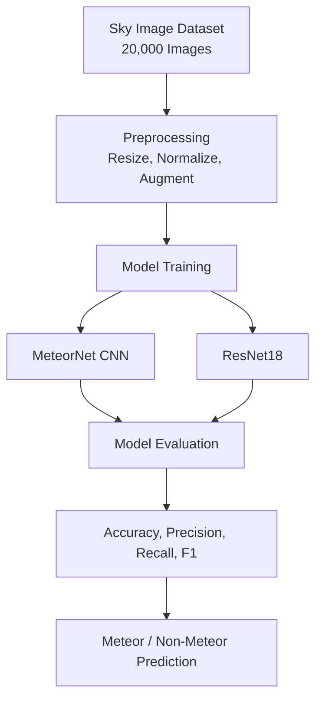
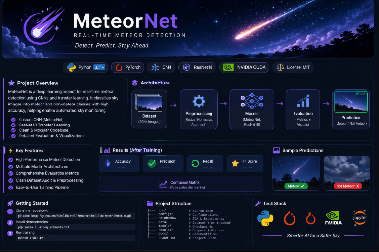

# ☄️ MeteorNet — Real-Time Meteor Detection

<div align="center">


### Real-Time Meteor Detection Using Deep Learning

**Detect. Predict. Stay Ahead.**

</div>

<p align="center">
  
  
  
  
  
</p>

---

## 🔭 Project Overview

MeteorNet is a deep-learning project designed to classify sky images into two categories:

- **Meteor (0):** Images containing meteor-like streaks.
- **Non-Meteor (1):** Images without meteor-like streaks.

The dataset contains **20,000 images**, with 10,000 images per class.

The project currently implements a custom Convolutional Neural Network (MeteorNet) and ResNet18 for image classification.

> **Current status:** Dataset inspection, initial model implementation and code preparation are complete. Full GPU training, leakage-resistant data splitting and final evaluation are pending. CPU smoke tests are pipeline checks, not final model results.

## ⚡ Key Features

- Custom MeteorNet CNN architecture.
- ResNet18 integration.
- Dataset inspection and bias analysis.
- Image preprocessing and augmentation.
- Training, evaluation and prediction scripts.
- Performance evaluation using classification metrics.

## 🏗️ System Architecture



## 📊 Results

*Final results will be added after full training and independent test evaluation on the college NVIDIA GPU.*

| Metric | Result |
|---|---|
| Accuracy | Pending |
| Precision | Pending |
| Recall | Pending |
| F1 Score | Pending |
| ROC-AUC | Pending |

Training graphs and confusion matrices will be added after evaluation.

## 🖼️ Dataset Samples

The dataset is organized into two classes:

| Meteor | Non-Meteor |
|---|---|
| Images from `meteor/` | Images from `non_meteor/` |

## 🛠️ Technology Stack

- Python
- PyTorch
- Torchvision
- NumPy
- Matplotlib
- Scikit-learn
- Pillow
- NVIDIA CUDA

## 📁 Project Structure

```text
MeteorNet/
│
├── assets/
│   ├── banner.png
│   └── readme_mockup_reference.png
│
├── src/
│   ├── dataset.py
│   ├── models.py
│   └── utils.py
│
├── models/                 # Model checkpoints (not tracked)
├── results/                # Generated results (not tracked)
│   ├── graphs/
│   └── metrics/
│
├── train.py
├── evaluate.py
├── predict.py
├── inspect_dataset.py
├── inspect_sources.py
│
├── DATASET_AUDIT.md
├── requirements.txt
├── README.md
└── .gitignore
```

## 🚀 Getting Started

### 1. Clone the Repository

```bash
git clone https://github.com/Nikhil306-ctrl/-MeteorNet-Real-Time-Meteor-Detection.git
cd -MeteorNet-Real-Time-Meteor-Detection
```

### 2. Create a Virtual Environment

**Windows PowerShell:**

```powershell
python -m venv .venv
.\.venv\Scripts\Activate.ps1
```

**Linux:**

```bash
python3 -m venv .venv
source .venv/bin/activate
```

### 3. Install Dependencies

```bash
python -m pip install --upgrade pip
pip install -r requirements.txt
```

### 4. Install PyTorch and Torchvision

PyTorch and Torchvision are intentionally installed separately from `requirements.txt`.

Use the official installation selector:

https://pytorch.org/get-started/locally/

For college NVIDIA GPU training, select a compatible CUDA installation based on the GPU and driver available on the machine.

Check GPU availability:

```bash
nvidia-smi
```

Verify PyTorch:

```bash
python -c "import torch; print(torch.__version__); print('CUDA:', torch.cuda.is_available())"
```

### 5. Prepare the Dataset

Obtain the dataset ZIP separately and extract it into the project root.

Expected structure:

```text
D_2 DATASET (METEORS)/
└── sum_images/
    ├── meteor/
    └── non_meteor/
```

Read `DATASET_AUDIT.md` before deciding the final train/validation/test split.

### 6. Run the Project

Check the available script options:

```bash
python train.py --help
python evaluate.py --help
python predict.py --help
```

Use the arguments shown by each script when running training, evaluation and prediction.

## 🔬 Training and Evaluation Workflow

1. Inspect and prepare the dataset.
2. Investigate possible data leakage and source bias.
3. Create a leakage-resistant train/validation/test split.
4. Train MeteorNet and ResNet18.
5. Perform full training using the college NVIDIA GPU.
6. Evaluate on an independent test set.
7. Generate performance graphs and evaluation metrics.
8. Compare model performance.

## ⚠️ Dataset and Evaluation Notes

- The dataset contains 10,000 images per class.
- Filename-year distributions differ between classes.
- Repeated filename groups were identified, especially in the non-meteor class.
- Exact duplicate scanning found no identical images; near-duplicates have not been ruled out.
- Filename IDs have not yet been verified as recording or camera identifiers.
- Random image-level splitting may cause related images to appear across different splits.

Refer to `DATASET_AUDIT.md` for the detailed findings.

## 🤝 Collaboration

Contributions should be made through separate Git branches rather than directly to `main`.

Create a branch:

```bash
git checkout -b feature/your-task
```

Commit and push changes:

```bash
git add .
git commit -m "Describe your changes"
git push -u origin feature/your-task
```

Open a Pull Request on GitHub for review.

## 📌 Repository

**GitHub:** [MeteorNet — Real-Time Meteor Detection](https://github.com/Nikhil306-ctrl/-MeteorNet-Real-Time-Meteor-Detection)

---

<div align="center">

### ☄️ MeteorNet

**Detect. Predict. Stay Ahead.**

*Building a smarter approach to automated sky-image analysis.*

## 🎨 Project Preview



</div>